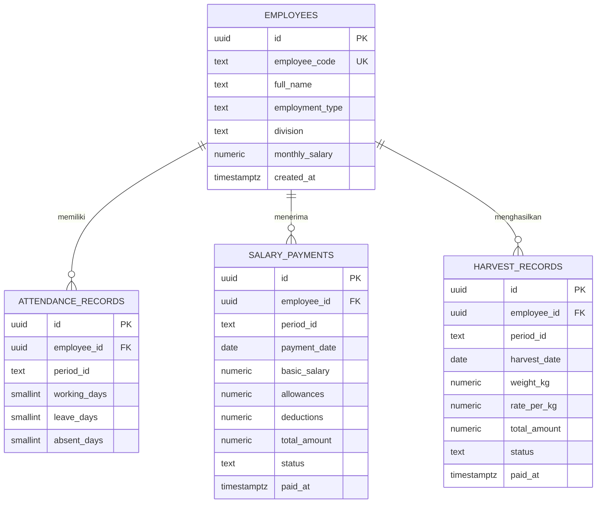

# Arboria — Sistem Penggajian dan Pengupahan Perkebunan

Arboria adalah aplikasi untuk mengelola data tenaga kerja perkebunan, absensi bulanan, gaji staf tetap, dan upah pemanen berdasarkan bobot hasil panen. Antarmuka dibuat dengan HTML, CSS, dan JavaScript; data terpusat disimpan di Supabase/PostgreSQL.

🌐 *Demo aplikasi:* [Buka Sistem Penggajian dan Pengupahan Perkebunan](https://nabilaawahdah.github.io/Sistem-Penggajian-dan-Pengupahan-Perkebunan/)

## Identitas tugas

| Keterangan | Detail |
|---|---|
| Nama | Nabila Wahdah Azzahra |
| NIM | 12030124130114 |
| Mata Kuliah | Pengkodean dan Pemograman |
| Kelas | D |
| Dosen Pengampu | Dr. Totok Dewayanto, S.E., M.Si., Akt. |

*Disusun untuk memenuhi Tugas Project UTS Pengkodean dan Pemograman.*

## Fitur Sistem

### Dashboard

- Menampilkan jumlah seluruh karyawan, staf, dan pemanen.
- Merangkum total gaji staf, upah panen, serta jumlah panen menurut satuan yang digunakan.
- Mengelompokkan jumlah biaya panen berdasarkan blok transaksi pada Dashboard.
- Menampilkan grafik arus kompensasi yang membandingkan gaji dan upah panen.
- Menyediakan aksi cepat untuk mencatat gaji staf atau hasil panen.
- Menampilkan transaksi terbaru dan akses ke daftar transaksi lengkap.

### Data Karyawan

- Menambah, melihat, mencari, mengubah, menghapus, dan memulihkan data karyawan.
- Memfilter daftar berdasarkan semua karyawan, staf, atau pemanen.
- Menyimpan kode karyawan, nama, jenis tenaga kerja, divisi/blok, serta gaji bulanan untuk staf.
- Untuk pemanen, pilihan blok adalah Blok A–D sesuai komoditas; gaji pokok bulanannya selalu 0.
- Karyawan yang dihapus disembunyikan dari input baru, tetapi tetap tersimpan bersama seluruh riwayat dan dapat dipulihkan.

### Absensi

- Mencatat status harian Hadir, Izin, atau Alfa untuk seluruh karyawan, dengan aksi tandai semua hadir.
- Menyediakan rekap bulanan per karyawan, pencarian, filter jenis tenaga kerja, dan detail tanggal.
- Menyimpan catatan harian unik per karyawan per tanggal; catatan bulanan lama tetap tersedia sebagai rekap historis tanpa tanggal rinci.

### Penggajian dan Pengupahan

- Mencatat gaji staf berdasarkan gaji pokok, tunjangan, dan potongan.
- Mencatat upah pemanen berdasarkan blok transaksi, komoditas, satuan, jumlah, dan tarif standar blok (tarif transaksi dapat diubah).
- Menampilkan ringkasan total gaji, upah, dan kompensasi.
- Memfilter transaksi menurut jenis dan status pembayaran.
- Mengunci transaksi setelah dicatat; pembayaran hanya dapat ditandai satu kali, sedangkan koreksi mencatat jurnal selisih tanpa mengubah transaksi asli.
- Menyelaraskan tanggal panen dengan periode yang dipilih.
- Membuat nomor slip berurutan saat pembayaran terjadi (`GS-YYYY-0001` untuk gaji staf, `UP-YYYY-0001` untuk upah panen); transaksi yang dibatalkan sebelum dibayar tidak memperoleh nomor atau slip.
- Membuka pratinjau slip pembayaran sebelum mengunduh PDF. Koreksi sebelum pembayaran digabungkan ke nilai akhir pada satu slip; koreksi positif setelah pembayaran memperoleh slip saat dibayar dan memuat nilai akhir, jumlah yang sudah dibayar, serta tambahan yang dibayar. Slip batal diberi watermark DIBATALKAN.

### Notifikasi

Tombol notifikasi menampilkan informasi bahwa tidak ada notifikasi hari ini.

### Akuntansi

- Daftar akun berisi kas/bank, utang gaji, utang upah, beban gaji staf, beban upah panen, dan potongan gaji.
- Jurnal umum dibuat otomatis oleh trigger database setiap transaksi dicatat atau dibayar. Jurnal harus seimbang sebelum disimpan.
- Pembatalan membuat satu jurnal pembalik yang seimbang untuk setiap jurnal asal (pengakuan, pembayaran, dan koreksi), dengan relasi ke jurnal asal; Jurnal Umum mengelompokkan jurnal-jurnal pembalik dari satu aksi sebagai satu blok tampilan.
- Buku besar menghitung saldo berjalan sesuai saldo normal dan menyediakan ringkasan neraca saldo.
- Riwayat aktivitas menyimpan aksi dicatat, dibayar, dan dibatalkan beserta waktu, pengguna demo, serta alasan pembatalan.

## Entitas Basis Data

Skema inti menyimpan empat tabel transaksi utama, tabel absensi harian, daftar akun, jurnal, dan audit trail.

### 1. `employees` — data induk karyawan

| Kolom | Keterangan |
| --- | --- |
| `id` | Primary key UUID yang dibuat otomatis. |
| `employee_code` | Kode karyawan, wajib dan unik. |
| `full_name` | Nama lengkap karyawan. |
| `employment_type` | Jenis tenaga kerja: `staff` atau `harvester`. |
| `division` | Divisi staf atau blok kerja pemanen. |
| `monthly_salary` | Gaji dasar bulanan; default 0 dan tidak boleh negatif. |
| `archived_at` | Waktu pengarsipan; `NULL` berarti karyawan aktif. Riwayat tidak dihapus. |
| `created_at` | Waktu pembuatan data. |

### 2. `attendance_records` — catatan absensi bulanan

| Kolom | Keterangan |
| --- | --- |
| `id` | Primary key UUID. |
| `employee_id` | Foreign key ke `employees.id`. |
| `period_id` | Periode dengan format `YYYY-MM`. |
| `working_days` | Jumlah hari kerja. |
| `leave_days` | Jumlah hari izin. |
| `absent_days` | Jumlah hari alfa. |
| `created_at`, `updated_at` | Timestamp dengan default `now()` saat record dibuat. `updated_at` belum diperbarui otomatis ketika record diedit. |

Kombinasi `employee_id` dan `period_id` harus unik. Nilai hari harus nonnegatif dan jumlahnya tidak boleh melebihi jumlah hari kalender dalam periode tersebut.

### 3. `salary_payments` — transaksi gaji staf

| Kolom | Keterangan |
| --- | --- |
| `id` | Primary key UUID. |
| `employee_id` | Foreign key ke `employees.id`. |
| `period_id` | Periode gaji dengan format `YYYY-MM`. |
| `payment_date` | Tanggal gaji yang ditetapkan. |
| `basic_salary` | Gaji pokok. |
| `allowances` | Tunjangan; default 0. |
| `deductions` | Potongan; default 0. |
| `total_amount` | Nilai hasil perhitungan otomatis database. |
| `status` | Status `paid`, `pending`, atau `cancelled`; transaksi yang sudah tersimpan tidak dapat diedit atau dihapus. |
| `paid_at` | Tanggal/waktu pembayaran aktual; dapat kosong jika belum dibayar. |
| `slip_number` | Kosong sebelum pembayaran; nomor bukti pembayaran otomatis yang unik setelah dibayar. |
| `created_at` | Waktu pembuatan transaksi. |

Rumus total gaji: `basic_salary + allowances - deductions`. Gaji pokok, tunjangan, dan potongan tidak boleh negatif; total gaji tidak boleh kurang dari nol.

### 4. `harvest_records` — transaksi hasil panen dan upah

| Kolom | Keterangan |
| --- | --- |
| `id` | Primary key UUID. |
| `employee_id` | Foreign key ke `employees.id`. |
| `period_id` | Periode panen dengan format `YYYY-MM`. |
| `block_code` | Blok panen yang dipilih pada transaksi, terpisah dari penempatan utama karyawan. |
| `commodity`, `unit` | Snapshot komoditas dan satuan dari master blok saat transaksi dicatat. |
| `harvest_date` | Tanggal panen. |
| `weight_kg` | Jumlah panen dalam satuan blok terpilih; nama kolom dipertahankan untuk kompatibilitas dan nilainya harus lebih dari nol. |
| `rate_per_kg` | Tarif untuk satu satuan blok terpilih; nama kolom dipertahankan untuk kompatibilitas dan nilainya tidak boleh negatif. |
| `deductions` | Kolom kompatibilitas untuk data lama; transaksi panen baru wajib bernilai 0. |
| `total_amount` | Nilai hasil perhitungan otomatis database. |
| `status` | Status `paid`, `pending`, atau `cancelled`; transaksi yang sudah tersimpan tidak dapat diedit atau dihapus. |
| `paid_at` | Tanggal/waktu pembayaran aktual; dapat kosong jika belum dibayar. |
| `slip_number` | Kosong sebelum pembayaran; nomor bukti pembayaran otomatis yang unik setelah dibayar. |
| `created_at` | Waktu pembuatan transaksi. |

Rumus upah panen baru: jumlah panen × tarif per satuan dari blok terpilih. Master `harvest_blocks` menyediakan Blok A–D; metadata komoditas, satuan, dan tarif standar dapat diisi sesuai konfigurasi kebun. Form panen tetap memungkinkan perubahan tarif.
Master `harvest_blocks` menggunakan `code` sebagai nama blok, serta `commodity`, `unit`, dan `standard_rate` untuk konfigurasi per blok.

Tabel akuntansi menggunakan `accounts`, `journals`, `journal_lines`, `payroll_corrections`, dan `payroll_audit_trail`. `journals` menyimpan header jurnal, `journal_lines` menyimpan akun serta debit/kredit, dan `payroll_corrections` menyimpan kolom koreksi. `transaction_kind` bersama `transaction_id` menghubungkan jurnal dengan transaksi gaji atau upah; jurnal terkait koreksi juga menyimpan `correction_id`. View `journal_view` menyajikan satu baris per akun dan nomor bukti yang dapat ditelusuri. Setelah migrasi, `payroll_journals` lama dipertahankan sebagai sumber arsip hingga hasil verifikasi disetujui; aplikasi membaca tabel baru. Catatan absensi harian disimpan di `daily_attendance`; `attendance_records` dipertahankan untuk rekap historis lama.

## ERD dan Relasi



### Penjelasan Relasi

- **`employees` ke `attendance_records`: satu ke banyak (1:N).** Seorang karyawan dapat memiliki catatan absensi pada banyak periode. Maksimal satu catatan diperbolehkan untuk satu karyawan dalam satu periode.
- **`employees` ke `salary_payments`: satu ke banyak (1:N).** Seorang karyawan dapat memiliki transaksi gaji pada banyak periode. Skema tidak menetapkan batas unik karyawan-periode untuk transaksi gaji.
- **`employees` ke `harvest_records`: satu ke banyak (1:N).** Seorang pemanen dapat memiliki banyak catatan panen, termasuk beberapa catatan dalam periode yang sama.
- Semua foreign key karyawan bersifat wajib (`NOT NULL`) dan menggunakan `ON DELETE RESTRICT`. Karyawan diarsipkan, bukan dihapus permanen, agar relasi dan riwayat transaksi tetap utuh.
- Tidak ada foreign key antara absensi dan tabel pembayaran, maupun ke tabel master periode. Periode disimpan langsung sebagai teks `YYYY-MM` pada setiap tabel terkait.

## Aturan dan Alur Kompensasi

1. Data karyawan dibuat terlebih dahulu; jenis tenaga kerja menentukan skema transaksi yang tersedia.
2. Absensi dicatat per karyawan dan bulan; constraint database serta validasi aplikasi menjaga keunikan dan jumlah hari.
3. Untuk staf, pengguna memilih periode dan mencatat gaji pokok, tunjangan, potongan, tanggal gaji, serta status. Database menghitung gaji bersih.
4. Untuk pemanen, pengguna memilih periode dan blok panen; komoditas, satuan, dan tarif standar mengikuti master blok. Tarif transaksi tetap dapat diubah. Tanggal panen harus berada pada bulan yang sama dengan periode; database menghitung upah dan Dashboard mengelompokkan biayanya memakai blok transaksi.
5. Jurnal staf mendebit `5-101 Beban Gaji Staf` untuk gaji pokok dan `5-103 Beban Tunjangan` untuk tunjangan, jika ada; potongan pada kolom `deductions` dikreditkan ke `5-104 Potongan Gaji`. Upah panen tetap dihitung dari bobot × tarif tanpa perubahan aturan jurnal.
6. `payment_date` adalah tanggal gaji; `harvest_date` adalah tanggal panen; `paid_at` mencatat waktu pelunasan aktual.
7. Jurnal pembayaran dibuat saat status berubah dari menunggu pembayaran menjadi dibayar. Transaksi yang telah dicatat tidak dapat diedit atau dihapus.
8. Transaksi dibatalkan menggunakan RPC database yang mensyaratkan alasan dan membuat satu jurnal pembalik seimbang per jurnal asal sebelum mengubah status transaksi.
9. Slip pembayaran tetap tersedia untuk transaksi yang dibayar. Laporan umum menggunakan dialog cetak browser dan opsi “Simpan sebagai PDF”; tidak menambah dependensi PDF baru.

## Struktur Proyek

```text
frontend/
  index.html
  styles.css
  script.js
backend/
  app.js
  schema.sql
README.md
```

`frontend` berisi antarmuka dan akses Supabase langsung untuk hosting statis. `backend/app.js` menyediakan API Node.js sebagai perantara untuk penggunaan melalui backend. Kedua jalur harus menunjuk ke project Supabase yang sama agar data tetap terpusat.

## Menghubungkan Supabase

1. Untuk project baru, jalankan `backend/schema.sql` satu kali di SQL Editor; file tersebut membangun skema akhir, termasuk jurnal ternormalisasi dan pengurutan tanpa `line_order`.
2. Untuk project lama yang belum dinormalisasi, jangan jalankan seluruh `schema.sql`. Jeda penulisan, jalankan hanya blok `BACKUP BLOCK`, lalu blok `NORMALIZATION MIGRATION BLOCK` seperti dijelaskan di dalam file.
3. Untuk database yang sudah memakai tabel `journals` dan `journal_lines`, jalankan blok `PRE-MIGRATION JOURNAL BASELINE` secara terpisah dan simpan hasilnya. Deploy aplikasi terbaru, jeda penulisan, lalu jalankan hanya blok `JOURNAL LINE ORDER MIGRATION`. Migrasi ini tidak membuat backup baru.
4. Bandingkan hasil sesudah migrasi dengan baseline: jumlah baris, total debit/kredit, saldo akun, dan keseimbangan per jurnal. Pastikan `journal_view` mengelompokkan jurnal dengan debit lebih dahulu dan akun berurutan sebelum melanjutkan penggunaan.
5. Untuk mengurutkan jenis jurnal dalam tanggal yang sama, jalankan hanya blok `JOURNAL VIEW TRANSACTION ORDER MIGRATION`. Urutannya per tanggal dan transaksi: pengakuan, koreksi, pembayaran, pembalik. Tanggal tetap menjadi urutan utama; perbedaan tanggal tidak diubah.
6. Untuk menampilkan nama karyawan langsung pada tabel absensi di Supabase, project lama dapat menjalankan hanya blok `ATTENDANCE EMPLOYEE FULL NAME MIGRATION`. Migrasi ini menambahkan `full_name` ke kedua tabel absensi dan menyinkronkannya dengan nama di `employees`.
7. Untuk project lama, jalankan blok `DAILY ATTENDANCE SUMMARY SYNC MIGRATION` agar `attendance_records` dihitung dari `daily_attendance` dan terus diperbarui saat data harian berubah. Bulan tanpa catatan harian tidak diubah oleh proses pengisian awal.
8. Untuk project yang melalui normalisasi jurnal, pertahankan `payroll_journals` lama dan backup sampai hasil verifikasi diperiksa dan disetujui. Jangan jalankan ulang blok backup jika snapshot bertanggal yang sama sudah ada.
9. Pastikan `SUPABASE_URL` dan publishable key yang digunakan frontend serta backend menunjuk ke project yang sama. Backend membaca `SUPABASE_PUBLISHABLE_KEY` (atau `SUPABASE_KEY` untuk kompatibilitas lama); jika memakai URL project selain default, keduanya wajib diatur. Jangan pernah menaruh `service_role` key di frontend.
10. Browser harus terhubung ke internet agar dapat membaca dan menyimpan perubahan ke Supabase. Jika koneksi cloud gagal pada host publik, aplikasi menampilkan peringatan dan tidak beralih diam-diam ke data lokal per perangkat.

## Keamanan

Row Level Security (RLS) aktif pada tabel aplikasi, tetapi mode demo memberi role `anon` akses luas ke data karyawan dan transaksi. Transaksi penggajian tetap dijaga trigger database dari perubahan dan penghapusan, tetapi izin pembatalan demo dapat dipanggil oleh klien yang mengetahui ID transaksi.

Konfigurasi ini hanya sesuai untuk demonstrasi atau data latihan. Sebelum menggunakan data karyawan dan penggajian nyata, terapkan autentikasi serta kebijakan RLS untuk role `authenticated` yang membatasi akses sesuai pengguna atau organisasi; ganti identitas demo “Admin Arboria” dengan identitas autentikasi tepercaya. Jangan pernah mengekspos `service_role` key.

## Catatan migrasi dan uji

- Untuk error `returned row structure does not match the structure of the triggering table` saat menyimpan gaji atau upah pada project yang sudah terkonsolidasi, jalankan hanya blok paling akhir berjudul “Fix the return row shape for compatibility-view triggers” di `backend/schema.sql`. Blok ini memperbaiki fungsi trigger tanpa mengubah data transaksi.
- Pada migrasi skema yang memang diperlukan, nomor slip transaksi lama yang sudah dibayar dipertahankan; nomor pada transaksi lama yang belum dibayar atau dibatalkan sebelum dibayar dikosongkan. Transaksi baru mendapat nomor saat pembayaran dari trigger database. Jurnal pembalik lama yang mencampur beberapa jurnal asal dipecah menjadi satu pembalik per jurnal asal, dan urutan baris per jurnal disimpan.
- Catatan absensi bulanan lama tidak dapat dipecah menjadi tanggal karena skema sebelumnya tidak menyimpan tanggal individual. Rekap lama tetap dihitung sebagai agregat sampai data harian mulai dicatat.
- Rekap absensi tidak menampilkan persentase kehadiran atau hari kerja efektif; hari tanpa input tidak dianggap Alfa.
- Master akun tetap disimpan di database dan dipakai oleh jurnal/buku besar, tetapi tidak ditampilkan sebagai menu atau halaman tersendiri.
- Karena status absensi hanya menyediakan Hadir, Izin, dan Alfa, kartu “Total izin” menampilkan jumlah status Izin; belum ada kategori Sakit tersendiri.
- Uji alur: catat gaji dengan status menunggu pembayaran; pastikan nomor slip belum terbit; koreksi beberapa kali lalu tandai dibayar dan pastikan satu slip memakai nilai akhir. Koreksi positif setelah dibayar harus memperoleh slip saat pembayaran tambahan dilakukan; koreksi negatif harus ditandai sebagai kelebihan bayar tanpa slip baru. Batalkan transaksi dan pastikan ada satu jurnal pembalik seimbang per jurnal asal, urutan pengakuan-pembayaran-koreksi benar, serta slip yang pernah terbit ber-watermark DIBATALKAN.


