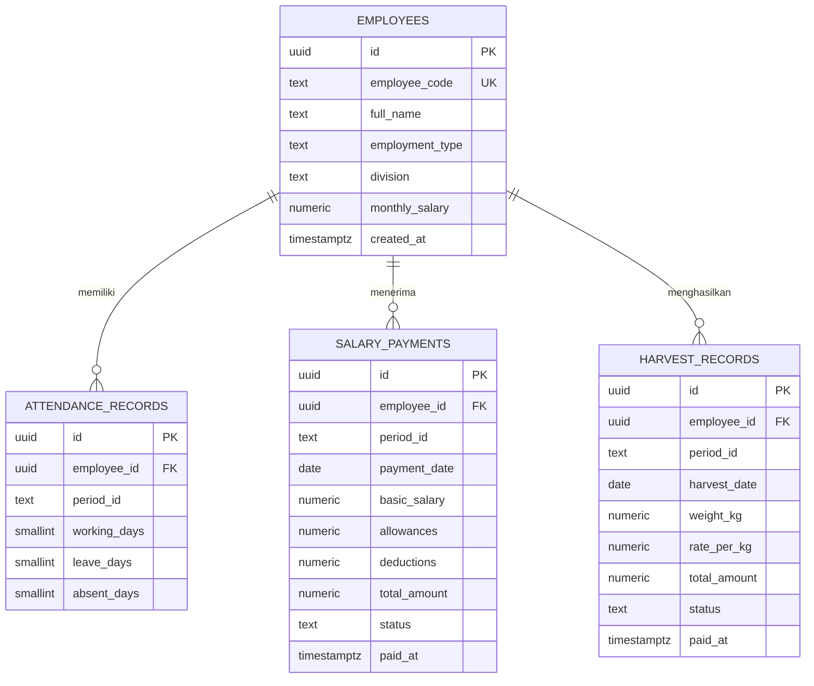

# Arboria — Sistem Penggajian dan Pengupahan Perkebunan

Arboria adalah aplikasi untuk mengelola data tenaga kerja perkebunan, absensi bulanan, gaji staf tetap, dan upah pemanen berdasarkan bobot hasil panen. Antarmuka dibuat dengan HTML, CSS, dan JavaScript; data terpusat disimpan di Supabase/PostgreSQL.

🌐 **Demo aplikasi:** [Buka Sistem Penggajian dan Pengupahan Perkebunan](https://nabilaawahdah.github.io/Sistem-Penggajian-dan-Pengupahan-Perkebunan/)

## Identitas tugas

| Keterangan | Detail |
|---|---|
| Nama | Nabila Wahdah Azzahra |
| NIM | 12030124130114 |
| Mata Kuliah | Pengkodean dan Pemograman |
| Kelas | D |
| Dosen Pengampu | Dr. Totok Dewayanto, S.E., M.Si., Akt. |

**Disusun untuk memenuhi Tugas Project UTS Pengkodean dan Pemograman.**

## Fitur Sistem

### Dashboard

- Menampilkan jumlah seluruh karyawan, staf, dan pemanen.
- Merangkum total gaji staf, upah panen, serta bobot panen pada periode terpilih.
- Menampilkan grafik arus kompensasi yang membandingkan gaji dan upah panen.
- Menyediakan aksi cepat untuk mencatat gaji staf atau hasil panen.
- Menampilkan transaksi terbaru dan akses ke daftar transaksi lengkap.

### Data Karyawan

- Menambah, melihat, mencari, mengubah, dan menghapus data karyawan.
- Memfilter daftar berdasarkan semua karyawan, staf, atau pemanen.
- Menyimpan kode karyawan, nama, jenis tenaga kerja, divisi/blok, serta gaji bulanan untuk staf.
- Penghapusan karyawan ditolak selama masih memiliki transaksi gaji, catatan panen, atau absensi agar riwayat tetap terjaga.

### Absensi

- Mencatat dan mengubah hari kerja, izin, serta alfa per karyawan dan periode bulanan.
- Mencegah lebih dari satu catatan absensi untuk karyawan yang sama pada periode yang sama.
- Memvalidasi agar total hari kerja, izin, dan alfa tidak melebihi jumlah hari kalender pada bulan tersebut.
- Menyediakan ringkasan dan filter periode.

### Penggajian dan Pengupahan

- Mencatat gaji staf berdasarkan gaji pokok, tunjangan, dan potongan.
- Mencatat upah pemanen berdasarkan bobot panen dan tarif per kilogram.
- Menampilkan ringkasan total gaji, upah, dan kompensasi.
- Memfilter transaksi menurut jenis dan status pembayaran.
- Mengubah transaksi, memperbarui tanggal pembayaran, menandai transaksi sebagai dibayar, dan menghapus transaksi.
- Menyelaraskan tanggal panen dengan periode yang dipilih.
- Membuka pratinjau slip pembayaran sebelum mengunduh PDF. Slip memuat data karyawan, jenis tenaga kerja, rincian pembayaran, tanggal pembayaran, tanda tangan, dan identitas Arboria.

### Notifikasi

Tombol notifikasi menampilkan informasi bahwa tidak ada notifikasi hari ini.

## Entitas Basis Data

Skema inti terdiri atas empat tabel.

### 1. `employees` — data induk karyawan

| Kolom | Keterangan |
| --- | --- |
| `id` | Primary key UUID yang dibuat otomatis. |
| `employee_code` | Kode karyawan, wajib dan unik. |
| `full_name` | Nama lengkap karyawan. |
| `employment_type` | Jenis tenaga kerja: `staff` atau `harvester`. |
| `division` | Divisi staf atau blok kerja pemanen. |
| `monthly_salary` | Gaji dasar bulanan; default 0 dan tidak boleh negatif. |
| `created_at` | Waktu pembuatan data. |

### 2. `attendance_records` — catatan absensi bulanan

| Kolom | Keterangan |
| --- | --- |
| `id` | Primary key UUID. |
| `employee_id` | Foreign key ke `employees.id`. |
| `period_id` | Periode dengan format `YYYY-MM`. |
| `working_days` | Jumlah hari kerja. |
| `leave_days` | Jumlah hari izin. |
| `absent_days` | Jumlah hari alfa. |
| `created_at`, `updated_at` | Timestamp dengan default `now()` saat record dibuat. `updated_at` belum diperbarui otomatis ketika record diedit. |

Kombinasi `employee_id` dan `period_id` harus unik. Nilai hari harus nonnegatif dan jumlahnya tidak boleh melebihi jumlah hari kalender dalam periode tersebut.

### 3. `salary_payments` — transaksi gaji staf

| Kolom | Keterangan |
| --- | --- |
| `id` | Primary key UUID. |
| `employee_id` | Foreign key ke `employees.id`. |
| `period_id` | Periode gaji dengan format `YYYY-MM`. |
| `payment_date` | Tanggal gaji yang ditetapkan. |
| `basic_salary` | Gaji pokok. |
| `allowances` | Tunjangan; default 0. |
| `deductions` | Potongan; default 0. |
| `total_amount` | Nilai hasil perhitungan otomatis database. |
| `status` | Status `paid` atau `pending`. |
| `paid_at` | Tanggal/waktu pembayaran aktual; dapat kosong jika belum dibayar. |
| `created_at` | Waktu pembuatan transaksi. |

Rumus total gaji: `basic_salary + allowances - deductions`. Gaji pokok, tunjangan, dan potongan tidak boleh negatif; total gaji tidak boleh kurang dari nol.

### 4. `harvest_records` — transaksi hasil panen dan upah

| Kolom | Keterangan |
| --- | --- |
| `id` | Primary key UUID. |
| `employee_id` | Foreign key ke `employees.id`. |
| `period_id` | Periode panen dengan format `YYYY-MM`. |
| `harvest_date` | Tanggal panen. |
| `weight_kg` | Bobot panen dalam kilogram; harus lebih dari nol. |
| `rate_per_kg` | Tarif per kilogram; tidak boleh negatif. |
| `total_amount` | Nilai hasil perhitungan otomatis database. |
| `status` | Status `paid` atau `pending`. |
| `paid_at` | Tanggal/waktu pembayaran aktual; dapat kosong jika belum dibayar. |
| `created_at` | Waktu pembuatan transaksi. |

Rumus total upah: `weight_kg × rate_per_kg`.

## ERD dan Relasi



### Penjelasan Relasi

- **`employees` ke `attendance_records`: satu ke banyak (1:N).** Seorang karyawan dapat memiliki catatan absensi pada banyak periode. Maksimal satu catatan diperbolehkan untuk satu karyawan dalam satu periode.
- **`employees` ke `salary_payments`: satu ke banyak (1:N).** Seorang karyawan dapat memiliki transaksi gaji pada banyak periode. Skema tidak menetapkan batas unik karyawan-periode untuk transaksi gaji.
- **`employees` ke `harvest_records`: satu ke banyak (1:N).** Seorang pemanen dapat memiliki banyak catatan panen, termasuk beberapa catatan dalam periode yang sama.
- Semua foreign key karyawan bersifat wajib (`NOT NULL`) dan menggunakan `ON DELETE RESTRICT`. Karyawan tidak dapat dihapus jika masih dirujuk absensi atau transaksi.
- Tidak ada foreign key antara absensi dan tabel pembayaran, maupun ke tabel master periode. Periode disimpan langsung sebagai teks `YYYY-MM` pada setiap tabel terkait.

## Aturan dan Alur Kompensasi

1. Data karyawan dibuat terlebih dahulu; jenis tenaga kerja menentukan skema transaksi yang tersedia.
2. Absensi dicatat per karyawan dan bulan; constraint database serta validasi aplikasi menjaga keunikan dan jumlah hari.
3. Untuk staf, pengguna memilih periode dan mencatat gaji pokok, tunjangan, potongan, tanggal gaji, serta status. Database menghitung gaji bersih.
4. Untuk pemanen, pengguna memilih periode dan mencatat tanggal panen, bobot, tarif, serta status. Tanggal panen harus berada pada bulan yang sama dengan periode; database menghitung upah.
5. `payment_date` adalah tanggal gaji; `harvest_date` adalah tanggal panen; `paid_at` mencatat waktu pelunasan aktual.
6. Transaksi berstatus dibayar dapat dipratinjau dan diunduh sebagai slip PDF.

## Struktur Proyek

```text
frontend/
  index.html
  styles.css
  script.js
backend/
  app.js
  schema.sql
README.md
```

`frontend` berisi antarmuka dan akses Supabase langsung untuk hosting statis. `backend/app.js` menyediakan API Node.js sebagai perantara untuk penggunaan melalui backend. Kedua jalur harus menunjuk ke project Supabase yang sama agar data tetap terpusat.

## Menghubungkan Supabase

1. Buat project Supabase dan jalankan skema terbaru `backend/schema.sql` di SQL Editor. Skrip membuat atau menyesuaikan empat tabel inti dan constraint-nya.
2. Pastikan `SUPABASE_URL` dan publishable key yang digunakan frontend serta backend menunjuk ke project yang sama. Jangan pernah menaruh `service_role` key di frontend.
3. Browser harus terhubung ke internet agar dapat membaca dan menyimpan perubahan ke Supabase. Jika koneksi cloud gagal pada host publik, aplikasi menampilkan peringatan dan tidak beralih diam-diam ke data lokal per perangkat.

## Keamanan

Row Level Security (RLS) aktif pada empat tabel, tetapi kebijakan yang ada memberi role `anon` akses baca, tambah, ubah, dan hapus ke seluruh data. Siapa pun yang dapat mengakses aplikasi berpotensi melihat atau mengubah data.

Konfigurasi ini hanya sesuai untuk demonstrasi atau data latihan. Sebelum menggunakan data karyawan dan penggajian nyata, terapkan autentikasi serta kebijakan RLS untuk role `authenticated` yang membatasi akses sesuai pengguna atau organisasi. Jangan pernah mengekspos `service_role` key.
